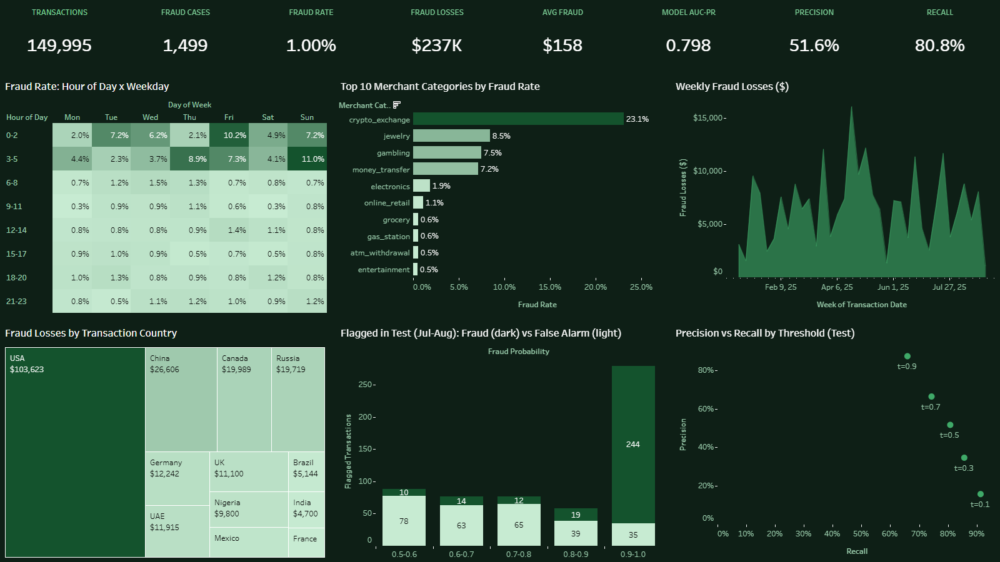

# Bank Card Fraud Detection

Flags fraudulent card transactions by comparing each transaction with the same account's own past behaviour: how fast it is transacting, how unusual the amount is, and whether the merchant type or country is new. End-to-end pipeline: Airflow, Great Expectations, dbt (past-only window features), PostgreSQL, XGBoost with SHAP reasons, and Excel and Tableau dashboards generated from code.

[](https://public.tableau.com/app/profile/palaksh.chaturvedi/viz/Fraud_Detection_17909480731190/FraudDetectionOverview)

**[Open the interactive dashboard on Tableau Public](https://public.tableau.com/app/profile/palaksh.chaturvedi/viz/Fraud_Detection_17909480731190/FraudDetectionOverview)**

## Results (time split: train January-June 2025, test July-August 2025)

| Approach | AUC-PR | AUC-ROC | Precision / recall at 0.5 |
|---|---|---|---|
| **XGBoost, class weights** | **0.798** | **0.978** | **0.516 / 0.808** |
| XGBoost, SMOTE | 0.783 | 0.975 | 0.810 / 0.714 |
| No-skill baseline | 0.0096 | 0.5 | - |

- With 1% fraud, AUC-PR is the headline metric: AUC-ROC barely moves with hundreds of false alarms.
- At threshold 0.5 the model raises about 9 alerts a day; half are real fraud, and it catches 81% of fraud. A threshold table (0.05 to 0.95) lets the business pick its own trade-off.
- Every flagged transaction comes with its top three SHAP reasons.
- A stratified random split gives a similar AUC-PR (0.787), which shows the leakage fixes worked (the first version scored a leaky 0.976).

**Known weak spots, stated plainly:**
- The data is synthetic (real labelled fraud data is confidential), so the model finds patterns the generator injected; the project proves the method, not a real bank's fraud rate.
- There is no simple baseline model (only the no-skill AUC-PR); a rule set or logistic regression is the natural next step.

## Pipeline

```
data/generator/generate_fraud_data.py -> 149,995 transactions, 3,000 customers, 1.0% fraud
  -> ingest (execute_values, 50k-row chunks) -> Great Expectations (12 expectations)
  -> dbt: past-only per-account velocity, amount ratios, novelty flags (27 tests)
  -> XGBoost (class weights vs SMOTE) + SHAP -> Excel + Tableau dashboards
```

9 Airflow tasks, triggered by hand. Stack: Docker Compose, Airflow 2.9.3, PostgreSQL 15, Great Expectations 0.18.19, dbt 1.7.13, XGBoost, imbalanced-learn, SHAP, openpyxl, Tableau Hyper API.

## Run it

```
cp .env.example .env                           # set POSTGRES_PASSWORD and HOST_PROJECT_DIR
python data/generator/generate_fraud_data.py   # needs numpy + pandas; writes data/raw/bank_transactions.csv (seeded)
docker compose up -d --build                   # Postgres :5435, Airflow UI http://localhost:8084
docker compose exec airflow-scheduler airflow dags trigger fraud_pipeline_dag
```

A full run takes about 2 minutes. The Airflow login is set in `docker-compose.yml` and is for local use only.

## More detail

[README_PIPELINE.md](README_PIPELINE.md) has the full architecture, the feature definitions, the leakage audit (with before and after numbers) and the verified run evidence.
